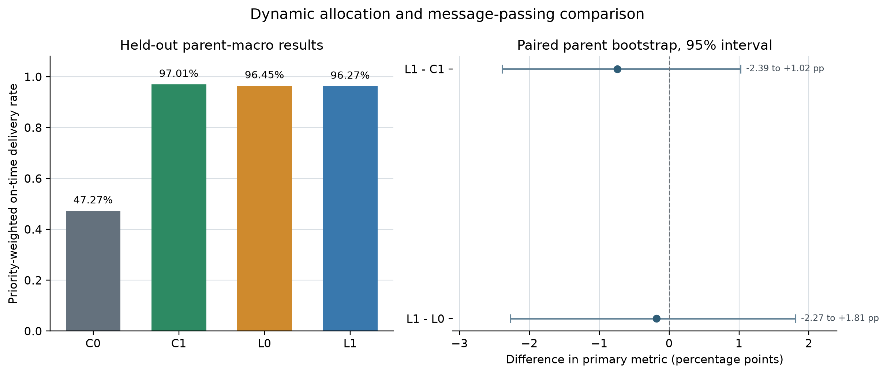
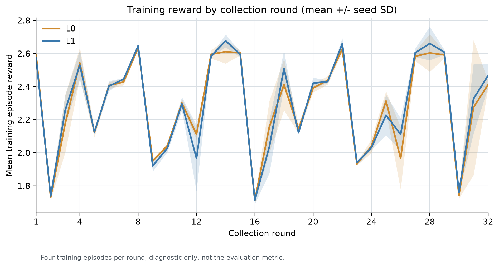

# 灾后巡查与运输中的图策略迁移小试

日期：2026-10-11。预登记协议：`disaster-relief-graph-transfer-v1`。本轮完成了新环境上的真实训练、检查点恢复核验、配对评价和独立轨迹审计。结果没有显示消息传递带来可辨认的提升；公开信息规则 C1 的点估计高于 L0 与 L1。本报告不据此推断算法无效、方法等价或可泛化。

## 结果摘要

主指标为父场景宏平均的优先级加权按时交付率。C0 保留初始队列，C1 使用公开信息规则，L0 为共享实体编码但无消息传递的 PPO，L1 为带图消息传递的 PPO。C0/C1 在每个父场景上各执行一次；L0/L1 使用种子 `8201/8202/8203`。

| 方法 | 加权按时交付率 | 巡查按时率 | 未满足订单/父场景 | 迟到订单/父场景 | 能耗/父场景 | 改派/父场景 | 推理墙钟 ms/分钟步 |
|---|---:|---:|---:|---:|---:|---:|---:|
| C0 | 47.2712% | 98.2143% | 2.0893 | 0.0357 | 4.6535 | 0.0000 | 0.0066 |
| C1 | 97.0105% | 100.0000% | 0.0714 | 0.0536 | 6.7013 | 3.0179 | 0.0057 |
| L0 | 96.4543% | 100.0000% | 0.0774 | 0.0714 | 6.9628 | 2.8750 | 1.8891 |
| L1 | 96.2714% | 100.0000% | 0.0893 | 0.0893 | 6.9906 | 2.7798 | 2.5305 |

除按时率外，表中订单数量、能耗和改派均按父场景取宏平均；L0/L1 再对三个训练 seed 等权平均。所有方法的块外承诺延误均为每父场景 0.0357 分钟，块外迟到订单均为每父场景 0.0179。新分配平均数为 C0 0、C1 1.9821、L0 1.9940、L1 1.9940。评价策略使用确定性动作选择。

L1 的主指标比 C1 低 0.7391 个百分点，父场景配对 bootstrap 95% 区间为 `[-2.3906, +1.0226]` 个百分点。L1 比 L0 低 0.1829 个百分点，区间为 `[-2.2719, +1.8076]` 个百分点。两区间均跨过零，且区间只对已观察的三个模型 seed 重采样 56 个配对父场景，不包括训练 seed 不确定性。

| 对比 | 均值差 | 8201 | 8202 | 8203 | 父场景配对 95% 区间 |
|---|---:|---:|---:|---:|---:|
| L1 − C1 | -0.7391 pp | -1.0524 pp | -1.3420 pp | +0.1770 pp | [-2.3906, +1.0226] pp |
| L1 − L0 | -0.1829 pp | -1.4523 pp | -0.0023 pp | +0.9059 pp | [-2.2719, +1.8076] pp |

C0 的表现明显低于其余方法，说明固定初始队列在本登记场景集中较弱。学习方法在本小试中没有超过 C1 的点估计，也没有观察到 L1 相对 L0 的消息传递优势。该结果是有限场景与三训练 seed 下的开发证据，不是等效性检验或广泛泛化结论。

## 训练与评价设计

六路正式训练均从新初始化开始；评价时加载各自最终 checkpoint。不读入旧 checkpoint 或旧任务数据。场景固定为 3 架无人机、1 架直升机、60 分钟期限。生成集按父场景隔离：训练 56 个、开发 14 个、评价 56 个；七类场景分别为无扰动、故障、能量变化、库存损失、报告延迟、组合扰动和外部承诺。训练与评价集每类各 8 个场景，开发集每类 2 个。所有评价方法使用相同评价父场景与外生事件。

L0/L1 配对采用相同场景次序、公开输入定义、动作空间、奖励函数和优化器；各策略按自身模型选择动作。每个模型训练 32 个采集轮次；每轮 4 个完整场景、240 个物理时间步，4 个 epoch、minibatch 60，每轮 16 次 optimizer update。六个正式运行合计 192 轮、3072 次 optimizer update 和 46,080 个环境转移；每个运行 512 次 optimizer update。工程短测通过了严格保存恢复等价性检查；六个正式最终 checkpoint 通过完整性校验和评价前严格模型加载屏障。

PPO 设置为 Adam `3e-4`、`gamma=0.99`、`lambda=0.95`、clip `0.2`、value 系数 `0.5`、entropy 系数 `0.01`、梯度范数上限 `0.5`。默认奖励为首次按时交付 `priority/5`、首次按时巡查报告 `0.1`、每单位实际运动/服务能耗 `-0.01`、初始任务首次换承运者 `-0.05`；不按隐藏需求总量归一化，重复报告与交付不重复奖励。模型选择和结论使用独立任务指标，不用训练 reward 代替评价。

L1 隐层维度为 64。L0 为宽度 89 的逐实体 MLP。有效可训练参数分别为 89,122 与 88,964，差异 0.178%，落在预设 ±5% 范围。六路模型每个 seed 的公共模块配对初始化摘要一致。曲线展示每轮四个训练场景的平均 reward，阴影为三个训练 seed 间的标准差；它仅作训练过程记录，没有按曲线或开发分数挑选 seed/检查点。

## 审计与资源

独立复核确认 192 个采集轮次、3072 次 optimizer update、46,080 个转移、六个最终 checkpoint 和 448 条完整评价轨迹；448 条轨迹的事件、任务/episode 指标及两个主对比均已独立复算。首次概率比误差为零。每个运行有 512 次 optimizer step；只有全 NOOP minibatch 中无梯度的四个 `pair_actor` 参数分别实际更新 500/501/508 次（L0）和 505/508/505 次（L1），其余有状态参数均为 512 次，这是记录到的优化器稀疏梯度行为，不是运行缺失。

目标端通过 Linux CPU 单线程运行，Python `3.11.16`、PyTorch `2.7.0+cu128`、NumPy `1.26.0`，未初始化 CUDA。训练阶段耗时 948.64 秒 wall、945.69 CPU 秒；评价与分析耗时 98.23 秒 wall、98.18 CPU 秒。包含先验成本及服务包络的已知合计为 1,112.45 秒 wall、1,106.35 CPU 秒。峰值 RSS 为 824,274,944 bytes，峰值工作/导出目录采样为 964,447,677 bytes；均低于登记的 4 GiB RSS 与 8 GiB 工作/导出上限。目录体积每 250 ms 采样，短时峰值可能漏采。

外层墙钟保护需作限定：目标 service 为 `Type=oneshot`，配置的 `RuntimeMaxSec` 不生效；`TimeoutStartUSec=infinity`，动态修正被拒绝。校正后的 watchdog timer 在正式服务退出后才启用，因而不能声称其覆盖本次运行。运行期间仍有先前 invocation-bound timer 与进程内阶段保护。上述资源数是当前 ledger、服务包络和先验成本可知范围的核算，不代表对传输、辅助 watchdog 和机器全系统开销的完整计量。

## 限制与解释

本轮不含世界模型、PreCo、多目标偏好控制或跨区域借机。单一任务规模与固定舰队下的小样本结果不支持数量泛化。56 个评价父场景现在已被查看，转为开发资料，不能再作为未来正式确认集。父场景区间不覆盖训练 seed 不确定性；每种学习架构也只有三个 seed。未按开发表现提前停止或追加轮次。

结论限于：救灾场景迁移、训练/恢复和配对评价闭环成功；本轮未观察到明确图消息传递收益，学习策略也未在主指标上超过 C1。需要新的预登记场景和独立训练种子，才能形成后续确认性结论。

## 可复核制品

冻结实现身份为 `bed250f4cc5c9cd001b9d5fe4b596780ccc24ac1ef9cd50dbdf3ea182a87a0f3`。来源摘要和变更清单位于冻结包 `package/SOURCE_REUSE_TRAINING.json`、`package/REUSE_IMPLEMENTATION.json`、`package/DEPLOYMENT_MANIFEST.json` 及 `package/REVIEW_RESPONSE.md`。本地稳定交付目录保留可运行源码、原始证据 tar、全部额外运行日志、六个最终 checkpoint、训练曲线、448 条完整轨迹、448 份任务行与独立审计、结果表和资源结算。完整 checkpoint 与原始服务器证据因尺寸和运行制品性质不纳入 GitHub，只在本地索引中列路径与 SHA-256。

原始正式证据包 SHA-256：`9259d39d8c8ec1950b2f6b27376c30068594f8e39ac6e0e4b055a065d296e3c3`。完整 checkpoint 路径和哈希见 [`../indexes/checkpoint_index.csv`](../indexes/checkpoint_index.csv)；独立复算 JSON 见 [`../evidence/independent_final_audit_result.json`](../evidence/independent_final_audit_result.json)，导出文件哈希清单见提取的 `evidence/extracted/run/export_manifest.json`。审计脚本作为来源记录复制；其路径根仍指向原 `.codex-tmp/ch2-graph-release-v2` 布局，不能从本稳定交付目录直接运行。
